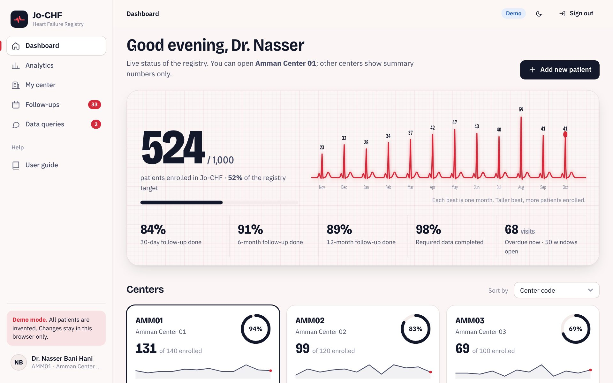
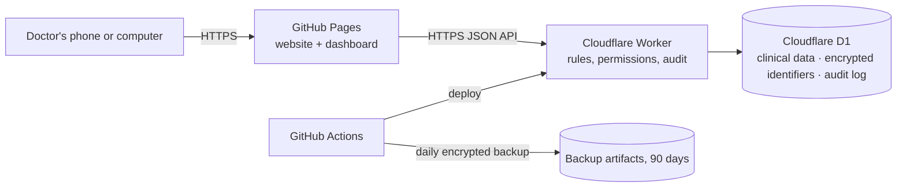

# Jo-CHF · Jordan Contemporary Heart Failure Registry

Electronic data capture and live analytics for **Jo-CHF**, a prospective multicenter registry of about 1,000 adults with heart failure across 10–20 centers in Jordan, followed at 30 days, 6 months and 12 months (ESC 2026 classification).

- **Open the registry:** https://aymankatwa-png.github.io/jo-chf/
- **User guide for doctors:** https://aymankatwa-png.github.io/jo-chf/guide/
- **Demo:** on the sign-in page press *Explore the demo* (500+ invented patients, password `demo1234`)



## What it does

| Area | Features |
|---|---|
| Accounts | Sign-in with email or numeric ID · registration requests approved by administrators · hashed passwords (PBKDF2-SHA256) · 30-minute idle sign-out · lock after 5 failed attempts · optional two-step verification (authenticator app) · temporary passwords and email reset |
| Roles | Administrators see all centers, de-identified · site investigators see their own center in full and other centers as summary cards only |
| Dashboard | Registry total vs 1,000 · enrollment "rhythm strip" · one card per center: recruitment vs target, 30-day / 6-month / 12-month follow-up completion, data completeness, overdue visits |
| Center page | Searchable, sortable patient list · follow-ups due (opening, open, missed) · open data queries |
| Patient record | Every section of the protocol in tabs · automatic Study ID · consent and eligibility gate · duplicate check without revealing the other record · DD/MM/YYYY dates · lab unit conversion · automatic age, BMI, eGFR (CKD-EPI 2021), phenotype, QRS category, KCCQ-12 domain scores · "not done / unknown" for required fields · autosave + offline drafts |
| Medications | Visit snapshots + titration log, pre-filling the next visit · target dose loaded per drug, % of target, ≥50% / 100% · required reason when not prescribed or below target · days to full foundational therapy · editable target-dose table |
| Follow-up | Windows calculated automatically · visit forms with medications, adherence, adverse events, labs, KCCQ · contact attempts, lost-to-follow-up after 3 attempts on different days |
| Outcomes | Hospitalizations with automatic HF-hospitalization classification · urgent HF visits · death with investigator and adjudicated cause · withdrawal of consent |
| Data quality | Range checks (blocking and warning) · completeness tracking · data queries with replies · record locking · deletion requests · append-only audit trail with old and new values |
| Export | Excel, CSV, SPSS, R with data dictionary · always de-identified · optional days-from-enrollment dates |
| Analytics | KPIs with confidence intervals · recruitment vs pace · age–sex pyramid · LVEF, NYHA, etiology, comorbidities by phenotype · GDMT over time · Sankey of therapy change · dose achievement · time to full therapy · reasons for non-prescription · Kaplan–Meier survival and HF-hospitalization-free survival with 95% CI · causes of death · KCCQ over time · NT-proBNP by NYHA · eGFR · iron deficiency cascade · devices · care opportunities · center benchmarking heat-map |

### Beyond the requirements
- **Patient journey** timeline: visits, events, the four drug classes shaded by dose intensity, KCCQ trend.
- **Guideline care opportunities**: automatic flags (missing SGLT2i, iron deficiency without IV iron, possible CRT candidates…) per patient and registry-wide.
- **Center benchmarking** heat-map for the steering committee.
- **Kaplan–Meier** curves with Greenwood confidence bands, computed live.
- **Light and dark themes**, phone-friendly layout, installable as an app.
- **Training sandbox**: the full system with invented patients that runs only in the browser (the separate test environment required by the protocol).

## How it is built



- **Website**: plain HTML, CSS and JavaScript modules (no build step). Charts: Apache ECharts. Excel: SheetJS. Fonts and libraries are hosted with the site.
- **Backend**: Cloudflare Worker + D1 (SQLite). One action endpoint `POST /api/<action>`.
- **One rulebook**: `assets/js/core/service.js` holds every permission and data rule. The Worker runs it on the server; the demo runs the same file in the browser.
- **Identifiers** (name, phones, file number, national ID) are encrypted with AES-256-GCM using the `PII_KEY` secret and kept apart from clinical data. Duplicate detection uses keyed hashes (HMAC), so it never reveals the other record.
- **Audit log** is an append-only table; database triggers refuse any edit or delete.

## Folders

```
index.html, config.js        the app (config.js holds the backend address)
assets/css/app.css           design system
assets/js/core/              logic.js (clinical calculations), schema.js (all form fields),
                             service.js (rules), analytics-calc.js, crypto.js, demo-seed.js
assets/js/pages/             screens
worker/                      Cloudflare Worker, D1 schema
guide/                       user guide for doctors
.github/workflows/           deploy-backend.yml, backup.yml
```

## Running it on your computer

```bash
python3 -m http.server 8080          # website in demo mode → http://localhost:8080
cd worker && npm install
echo "PII_KEY=local-key-at-least-24-characters" > .dev.vars
npx wrangler d1 execute jo-chf --local --file=schema.sql
npx wrangler dev --local --var ALLOW_LOCALHOST:1     # backend → http://localhost:8787
```
Then set `API_URL` in `config.js` to the backend address.

Deployment: see **[SETUP.md](SETUP.md)**.

## Before real patients
- Confirm hosting with the ethics committees and Jordanian data-protection requirements (Cloudflare stores data in its own data centers).
- Confirm the KCCQ-12 license; paste the licensed Arabic wording in *Study settings*.
- Check target doses against the final ESC 2026 tables (*Study settings*).
- Confirm follow-up window start for inpatients (enrollment or discharge) in *Study settings*.

---
Built for the Jo-CHF study team. All demo patients are invented.
